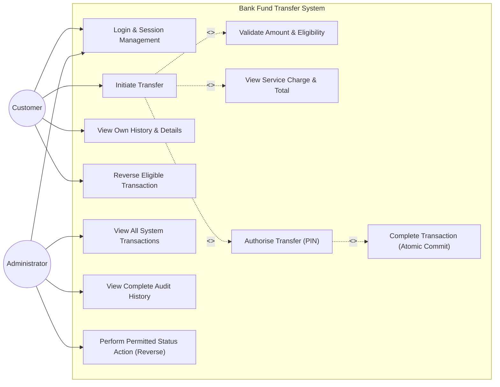
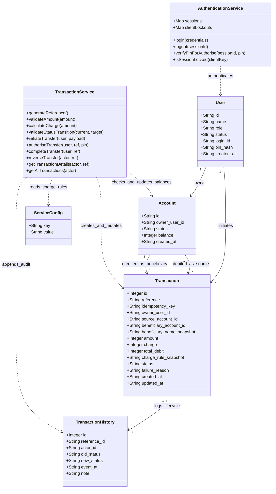

# Software Engineering SAT II – UML Diagrams

This document contains the two required architectural diagrams for the Bank Fund Transfer System (Use Case Diagram and Class Diagram) rendered in Mermaid. PlantUML source files are also provided as [`docs/use-case.puml`](file:///docs/use-case.puml) and [`docs/class-diagram.puml`](file:///docs/class-diagram.puml).

---

## 1. Use Case Diagram

---

## 2. Class Diagram

